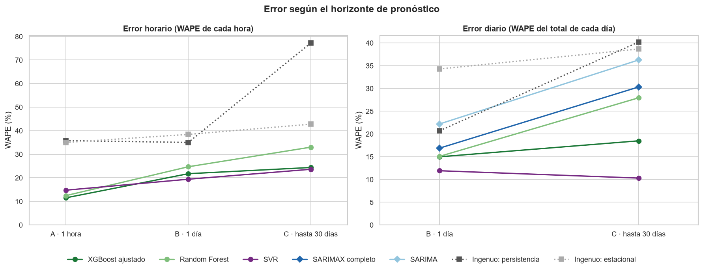
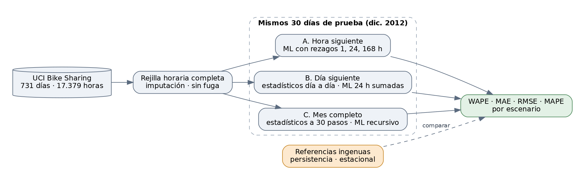

# Bike Sharing: pronóstico de demanda por horizonte

Pronóstico de la demanda de bicicletas compartidas de Capital Bikeshare (Washington D.C., 2011–2012) con modelos estadísticos (ARIMA, SARIMA, SARIMAX) y de machine learning (Ridge, SVR, Random Forest, XGBoost).

La pregunta central es cuál conviene usar, y la respuesta depende de **con cuánta anticipación** se pronostica. Un modelo que conoce la demanda de la hora anterior no compite en las mismas condiciones que uno que pronostica un mes completo. Por eso los modelos se comparan en tres escenarios con horizontes distintos, sobre los mismos 30 días de prueba (2 al 31 de diciembre de 2012) y siempre frente a referencias ingenuas.



## Tres escenarios



| Escenario | Pregunta | Información disponible | Modelos |
| --- | --- | --- | --- |
| **A. Hora siguiente** | ¿Cuántos alquileres en la hora h? | Demanda real hasta h − 1 | ML horario con rezagos de 1, 24 y 168 h |
| **B. Día siguiente** | Al cierre de cada día, ¿cuántos alquileres mañana? | Demanda real hasta las 23:00 de hoy | Estadísticos actualizados día a día; ML que predice las 24 horas de mañana y las suma |
| **C. Mes completo** | El 1 de diciembre, ¿cuántos alquileres cada día de los 30 siguientes? | Demanda real hasta el 1 de diciembre | Estadísticos a 30 pasos; ML recursivo que usa sus propias predicciones como rezagos |

- **Referencias ingenuas** en cada escenario: *persistencia* (repetir el último valor disponible) y *estacional* (la misma hora de ayer en A; el mismo día de la semana anterior en B y C). Un modelo que no las supera no aporta.
- **Clima conocido de antemano** en todos los escenarios: se usa el clima registrado de los días pronosticados. Es un supuesto optimista e igual para todos los modelos.
- **Métricas:** MAE, RMSE, MAPE y WAPE (error absoluto total entre demanda total). La lectura principal usa el WAPE porque el MAPE se dispara en los días de muy baja demanda de fin de año; además, al ser relativo, permite comparar horizontes.

## Resultados

Cada escenario tiene su propia tabla; las cifras de horizontes distintos no se mezclan. Selección de modelos; las tablas completas están en [`results/`](results/) y en el notebook [04](notebooks/04_comparacion_por_escenario.ipynb).

**A. Hora siguiente** (error por hora)

| Modelo | WAPE | MAE (alquileres/hora) |
| --- | ---: | ---: |
| XGBoost ajustado | 11,5 % | 19,0 |
| Random Forest | 12,4 % | 20,5 |
| SVR | 14,8 % | 24,3 |
| Ridge | 24,4 % | 40,2 |
| Ingenuo: estacional (misma hora de ayer) | 35,0 % | 57,6 |
| Ingenuo: persistencia (hora anterior) | 35,8 % | 59,0 |

**B. Día siguiente** (error del total diario)

| Modelo | WAPE | MAE (alquileres/día) |
| --- | ---: | ---: |
| SVR | 11,9 % | 471 |
| XGBoost | 14,3 % | 565 |
| XGBoost ajustado | 15,0 % | 592 |
| SARIMAX (clima + festivo) | 16,9 % | 667 |
| Ingenuo: persistencia (ayer) | 20,7 % | 818 |
| ARIMA(1, 1, 1) | 22,1 % | 874 |
| SARIMA(2, 1, 1)(0, 1, 1)₇ | 22,2 % | 877 |

**C. Mes completo** (error del total diario)

| Modelo | WAPE | MAE (alquileres/día) |
| --- | ---: | ---: |
| SVR | 10,3 % | 407 |
| XGBoost ajustado | 18,5 % | 730 |
| Random Forest | 27,9 % | 1.104 |
| SARIMAX (clima + festivo) | 30,3 % | 1.198 |
| SARIMA(2, 1, 1)(0, 1, 1)₇ | 36,3 % | 1.432 |
| Ingenuo: estacional (última semana) | 38,7 % | 1.528 |
| ARIMA(1, 1, 1) | 39,1 % | 1.543 |

### Lectura

- **La ventaja a una hora no se traslada a horizontes más largos.** Medido hora por hora (panel izquierdo de la figura), el WAPE de XGBoost ajustado pasa del 11,5 % a una hora al 21,8 % a un día. Buena parte de su precisión a corto plazo viene de conocer la demanda de la hora anterior. Al sumar sus predicciones horarias por día, los errores de signo opuesto se compensan, y el error del total diario en el escenario B baja al 15,0 % (tabla B).
- **Sin clima, la dinámica de la serie no basta.** A un día, ARIMA y SARIMA no superan a la persistencia (repetir el total de ayer). Lo que aporta es el clima: SARIMAX baja el error del total diario del 22,2 % al 16,9 %.
- **La semana de fiestas decide el orden.** Del 2 al 21 de diciembre, en el escenario B, los mejores modelos quedan casi empatados en el error del total diario (Random Forest 8,8 %, SVR 9,1 %, XGBoost 9,5 %, SARIMAX 9,9 %). Las diferencias de la tabla vienen de los diez días entre el 22 y el 31 de diciembre, cuando la demanda cae a una fracción de la habitual y el SVR es el que mejor sigue la caída.
- **El modelo recomendado es XGBoost ajustado.** El SVR gana en la prueba de B y C, pero es el peor y el más inestable en la validación cruzada sobre año y medio de datos. Con 30 días de prueba, diez de ellos atípicos, la selección se hace por validación, donde XGBoost es el mejor tanto a una hora como a un día. Además, supera a las referencias en los tres horizontes.
- **Estadístico o machine learning.** SARIMAX es competitivo para el total diario a pocos días, con coeficientes interpretables (cada grado de temperatura suma unos 100 alquileres al día; un día de lluvia o nieve resta unos 1.500) e intervalos de predicción. El machine learning es preferible cuando se necesita granularidad horaria o el horizonte es largo, porque reconstruye el perfil de cada día con el calendario y el clima en lugar de prolongar el nivel reciente.
- **Por tipo de día y estación**, el error es mayor en fines de semana y festivos y en invierno, cuando la demanda es menor y depende más del tiempo y de los usuarios ocasionales.

## Datos y preparación

[Bike Sharing Dataset](https://archive.ics.uci.edu/dataset/275/bike+sharing+dataset) de UCI: 731 días y 17.379 horas de alquileres, con clima y calendario. Se descarga automáticamente y se verifica con SHA-256.

- **Rejilla horaria completa.** Faltan 165 de las 17.544 horas. Son horas sin alquileres (madrugadas, enero de 2011 y el cierre por el huracán Sandy): la suma diaria de `hour.csv` ya coincide con `day.csv` sin ellas. Se imputan con demanda 0, el clima se interpola y la situación del tiempo arrastra el último valor. Así los rezagos (`shift(24)` = misma hora de ayer) son exactos.
- **Sensor de humedad.** El 2011-03-10 registra humedad 0 %, un valor imposible en un día de lluvia; se imputa.
- **Variables excluidas.** `casual` y `registered` suman la demanda y serían una fuga del objetivo; `atemp` es colineal con `temp` (r = 0,99).
- **Sin fuga de información.** Cada escenario construye sus variables solo con lo disponible en el momento del pronóstico. Las pruebas reemplazan por ruido la demanda posterior al instante permitido y verifican que ninguna variable cambia.

## Modelos

- **ARIMA(1, 1, 1)**, propuesto por ACF y PACF, frente a **ARIMA(2, 1, 2)** de `auto_arima`.
- **SARIMA(2, 1, 1)(0, 1, 1)₇**, el mejor por AIC y BIC en una búsqueda de órdenes, respaldado por la ACF de la serie diferenciada (pico en el rezago 7 y nada en el 14).
- **SARIMAX** con temperatura, humedad, viento, situación del tiempo y festivo; también con solo clima y solo calendario. `workingday` no entra: con la diferencia estacional de 7 días queda perfectamente colineal con `holiday`.
- **Ridge, SVR, Random Forest y XGBoost** sobre la serie horaria, validados con `TimeSeriesSplit` de 5 particiones (un reparto aleatorio mezclaría el futuro en el entrenamiento) y con búsqueda de hiperparámetros sobre el mejor.

## Limitaciones y mejoras

- El clima de los días pronosticados se supone conocido; con un pronóstico meteorológico real los errores serían mayores.
- La prueba son 30 días de diciembre, con la semana de fiestas incluida, y el entrenamiento contiene una sola Navidad completa.
- Dos mejoras concretas: agregar **variables de temporada festiva** (del 22 de diciembre al 1 de enero, Acción de Gracias, distancia al festivo más cercano), que es donde se concentra el error de todos los modelos, y evaluar con **origen móvil** a lo largo de 2012 en lugar de un único bloque de 30 días.

## Estructura

```
bike-sharing/
├── src/bike_sharing/
│   ├── datos.py           descarga verificada, integridad, rejilla horaria e imputación
│   ├── variables.py       variables por escenario sin fuga de información
│   ├── estadisticos.py    ARIMA, SARIMA y SARIMAX; pronóstico día a día y a 30 días
│   ├── ml.py              modelos, validación temporal y búsqueda de hiperparámetros
│   ├── escenarios.py      escenarios A, B y C y referencias ingenuas
│   └── evaluacion.py      MAE, RMSE, MAPE y WAPE
├── scripts/run.py         ajusta todo y guarda los resultados
├── notebooks/
│   ├── 01_exploracion.ipynb
│   ├── 02_modelos_estadisticos.ipynb
│   ├── 03_machine_learning.ipynb
│   └── 04_comparacion_por_escenario.ipynb
├── results/               métricas (JSON), predicciones (CSV) y figuras
└── tests/                 integridad de datos, no fuga, métricas y escenarios
```

## Cómo reproducir

Requiere Python 3.13.

```bash
git clone https://github.com/Santy012/bike-sharing.git
cd bike-sharing
python -m venv .venv
# Windows: .venv\Scripts\activate    Linux/macOS: source .venv/bin/activate
pip install -r requirements.txt

pytest                    # 29 pruebas
python scripts/run.py     # unos 25 minutos en un portátil; escribe results/
```

Los notebooks leen `results/` y se pueden abrir directamente: los resultados ya están incluidos en el repositorio. Todos los procesos aleatorios usan `random_state = 42`.

## Autores

Santiago Castellanos y Sara Romero.

## Licencia

El código se publica bajo la licencia [MIT](LICENSE). El dataset conserva su propia licencia (CC BY 4.0, ver abajo).

## Datos

Fanaee-T, H. y Gama, J. (2013). *Event labeling combining ensemble detectors and background knowledge*. Progress in Artificial Intelligence, 2, 113–127. Dataset disponible en el [UCI Machine Learning Repository](https://archive.ics.uci.edu/dataset/275/bike+sharing+dataset) (CC BY 4.0).
